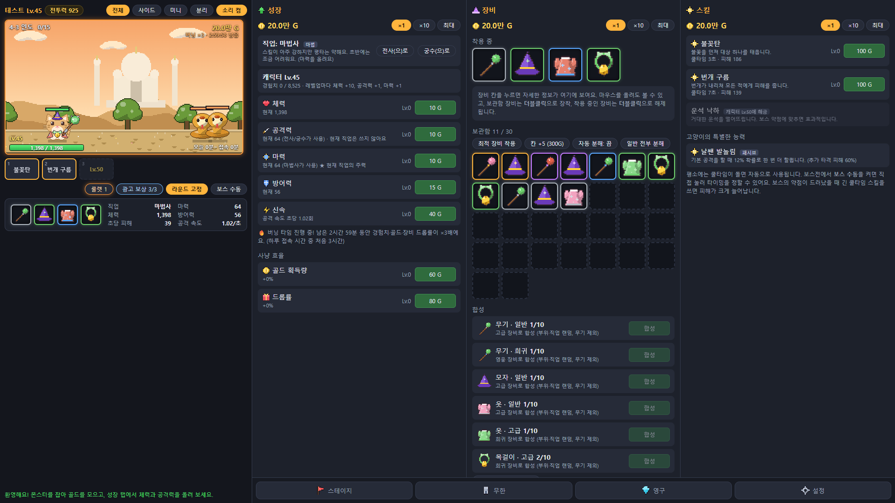
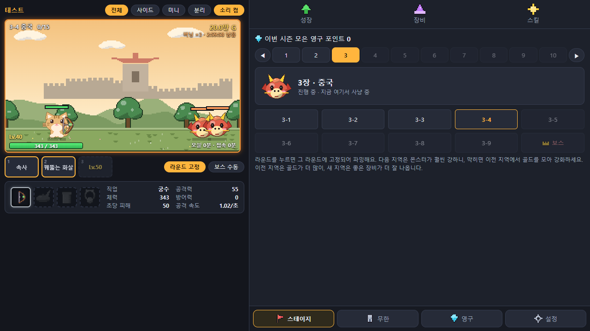
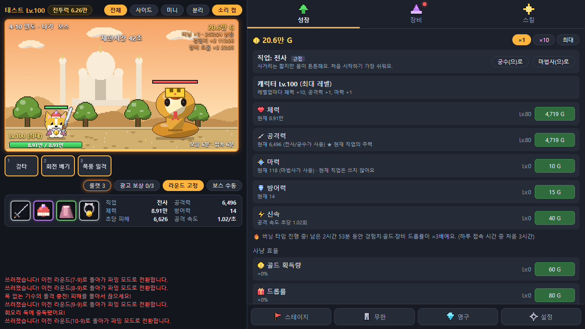
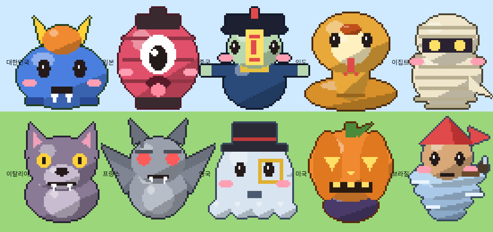

# 방치형 모험 — 시즌제 방치형 로그라이크 웹게임

동물 모험가(강아지/고양이)가 전 세계를 돌며 나라별 전통 요괴를 물리치는 **시즌제 방치형 웹게임**입니다.
2주마다 시즌이 리셋되고, 일부 성장(영구 포인트·칭호)만 이어지는 구조에 **서버 검증 랭킹(무한 모드)** 을 붙였습니다.
순수 HTML/JS 클라이언트 + Cloudflare Workers/D1 서버로, 로그인·저장·시즌 전환·부정행위 검증까지 직접 구현했습니다.



## 주요 기능
- **자동 전투 + 보스 수동 스킬**: 평소엔 자동, 보스전에서는 약점 타이밍에 직접 스킬을 쓰면 피해가 크게 증가
- **나라별 10개 지역과 보스 패턴**: 한국 도깨비(충전 후 큰 한 방, 끊기), 일본 오니(독), 중국 강시(스킬 봉인), 이집트 미라(졸개 소환), 프랑스 가고일(방어막) 등 지역마다 다른 기믹
- **직업 3종 × 동물 2종**: 전사/궁수/마법사 스킬 트리, 동물별 은근한 패시브. 직업 교체, 장비 합성·강화·분해
- **시즌/영구 성장**: 시즌 리셋 시 닉네임·영구 투자·칭호 유지, 영구 포인트 투자 시스템
- **무한 모드 + 랭킹**: 최고 층 순위(동률은 먼저 도달), 시즌 종료 시 순위 보상과 칭호 자동 지급
- **버닝 타임·룰렛·보상형 광고(시험용)**: 접속 시간 기반 보너스를 서버가 검증
- **반응형 UI**: PC(큰 화면은 3열 동시 표시)·모바일, 사이드/미니/PiP 모드, 소리(WebAudio 합성, 외부 음원 없음)
- **모든 그래픽을 코드로 생성**: 캐릭터·몬스터·장비·배경·아이콘 전부 Canvas로 그린 도트(저작권 이슈 없음)

| 스테이지(챕터) | 보스 패턴 |
|---|---|
|  |  |




## 기술 스택
- **클라이언트**: Vanilla JS(ES2020), Canvas 2D, WebAudio, CSS — 빌드 도구 없음
- **서버**: Cloudflare Workers + D1(SQLite), Web Crypto(PBKDF2-SHA256 비밀번호 해시, 세션 토큰)
- **테스트**: Node 통합 테스트 106개(API·검증·시즌·보상), Puppeteer E2E, 밸런스 시뮬레이터

## 설계 포인트
- **게임 규칙 한 벌을 클라이언트와 서버가 공유**: `client/js/{config,game}.js`를 서버가 그대로 가져가 같은 규칙으로 검증합니다(`npm run sync`).
- **시드 기반 전투 로직(DOM과 분리)**: 같은 입력이면 같은 결과가 나오므로 서버에서 다시 시뮬레이션해 랭킹 기록을 검증할 수 있습니다. 무한 모드 기록은 시간·장비 능력치·투자 골드·시뮬레이션 도달 가능성으로 확인하고, 통과하지 못하면 기록만 되돌립니다.
- **저장 검증**: 플레이 시간, 진행도 점프, 영구 포인트/티켓/버프 증가량, 칭호·보상 조작을 서버가 거부하거나 기록합니다.
- **접속 중에만 진행**: 오프라인 보상이 없는 구조에 맞춰 단일 세션(새 로그인이 기존 접속을 끊음), 하루 접속 시간 서버 검증.
- **시즌 지연 전환(lazy rollover)**: 크론 없이, 접속 시점에 서버가 시즌 경계를 확인해 리셋·순위 보상을 지급.
- **밸런스 시뮬레이터**(`tools/`): 사람처럼 투자·파밍하는 봇으로 "10지역 클리어 시간"을 측정해 지역별 난이도 보정값을 자동 계산.
- **개발/라이브 환경 분리**: 별도 Worker·D1로 개발 서버를 두고, 확인 후 라이브에 배포.

## 폴더 구조
- `client/` 게임 화면. 규칙·밸런스는 `js/config.js`, `js/game.js`. 그래픽은 `js/chars.js`(캐릭터·장비), `monsters.js`, `landmarks.js`, `icons.js`
- `server/` Cloudflare Workers 서버 (`src/index.js` API, `savelogic.js` 검증, `season.js`, `schema.sql`)
- `tools/` 밸런스 시뮬레이터(`sim.js`, `calibrate.js`)
- `기획서.md` 기획 문서(결정 사항과 근거)

## 실행 방법
```bash
cd server
npm install
npm run db:init      # 로컬 DB 생성
npm run dev          # http://127.0.0.1:8787
npm test             # (서버를 켠 상태에서) 통합 테스트
```
Windows에서는 `서버시작.bat`을 더블클릭하면 설치부터 실행까지 한 번에 됩니다. `client/index.html`을 직접 열면 서버 없이 시험 모드로 동작합니다.

운영자 화면(`/admin.html`)은 서버에 `ADMIN_KEY`를 설정해야 열립니다. 로컬에서는 `server/.dev.vars`에 `ADMIN_KEY=아무값`을 적으세요.

## 개발 방식
기획·디자인 방향과 모든 의사결정은 직접 하고, 구현은 AI 코딩 도구(Claude Code)와 협업해 진행했습니다.

## 참고
세계관·그래픽·이름은 모두 독자 제작이며, 방치형 장르의 일반적인 재미 요소에서 영감을 받았습니다.
